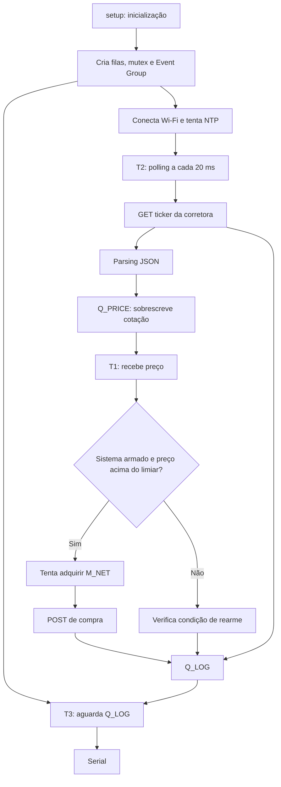
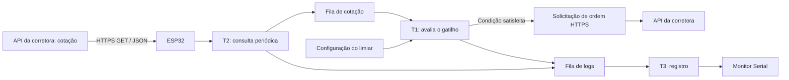

# Arquitetura do projeto

Este documento apresenta dois retratos distintos: a implementação encontrada no repositório consultado e a arquitetura funcional descrita na proposta do grupo. A arquitetura-alvo deverá ser consolidada após a resolução das pendências em [`docs/DECISIONS_PENDING.md`](docs/DECISIONS_PENDING.md).

## 1. Objetivo e limites do sistema

O sistema embarcado utiliza um ESP32 conectado à internet por Wi-Fi. Ele consulta a cotação de um ativo na API de uma corretora, avalia um limiar configurado e, quando a condição de negociação é satisfeita, envia uma requisição para criação de uma ordem. A interface serial fornece registros locais do funcionamento.

O núcleo de tempo real é o firmware executado no ESP32: tarefas, filas, sincronização, temporização e controle do fluxo de decisão. A API da corretora é um serviço externo; seu processamento não está sob controle do escalonador FreeRTOS.

## 2. Implementação observada no repositório

**Snapshot analisado:** branch `Develop`, em 13/11/2026. Arquivos consultados: `platformio.ini`, `src/main.cpp` e `include/config.h`.

A configuração de build utiliza PlatformIO com `framework = arduino`, placa `esp32dev` e dependência ArduinoJson 7. O código funcional principal está concentrado em `src/main.cpp`; não foi encontrado um README na raiz nessa branch durante a consulta.

### 2.1 Sequência de inicialização atual

1. `setup()` inicia a Serial e cria `Q_PRICE`, `Q_LOG`, `M_NET` e `EG_SYS`.
2. Cria T3, a tarefa de registro.
3. Inicia a conexão Wi-Fi e aguarda indefinidamente até conectar.
4. Marca o bit de Wi-Fi no Event Group.
5. Tenta sincronizar o relógio via NTP e, se obtiver horário, marca o bit `TIME_OK_BIT`.
6. Cria T2 e T1.
7. `loop()` termina sua própria tarefa com `vTaskDelete(NULL)`.

A rotina de conexão Wi-Fi não possui timeout no código consultado. A sincronização NTP é tentada uma vez durante a inicialização.

### 2.2 Recursos FreeRTOS atuais

| Identificador | Tipo | Uso observado |
|---|---|---|
| `Q_PRICE` | Fila de tamanho 1 | Transporta um `float` com a cotação mais recente de T2 para T1. `xQueueOverwrite()` substitui o valor anterior. |
| `Q_LOG` | Fila de tamanho 16 | Transporta mensagens `LogMessage` para T3. |
| `M_NET` | Mutex | Serializa o uso de `HTTPClient` nas rotinas de consulta e envio de ordem. |
| `EG_SYS` | Event Group | Registra os estados de Wi-Fi conectado e horário NTP sincronizado. |

O envio de logs usa `xQueueSend(..., 0)`, sem aguardar espaço. Se a fila estiver cheia, a mensagem pode ser descartada. A fila de preço tem tamanho 1 intencionalmente: ela favorece o valor mais recente em vez de preservar todas as cotações intermediárias.

### 2.3 Tarefas atuais

| Tarefa | Prioridade usada no código | Ativação/comportamento | Responsabilidade observada |
|---|---:|---|---|
| T1 — `vTaskGatilho` | 3 | Aguarda `Q_PRICE`; portanto, fica bloqueada até chegar uma cotação. | Compara o preço com o limiar, tenta enviar uma compra e controla o rearme. |
| T2 — `vTaskConsulta` | 2 | Periódica, com `vTaskDelayUntil()` e intervalo de 20 ms. | Consulta o ticker HTTP, interpreta o JSON e sobrescreve `Q_PRICE`. |
| T3 — `vTaskRegistro` | 1 | Aguarda `Q_LOG` com `portMAX_DELAY`. | Imprime mensagens recebidas na Serial. |

As três tarefas são criadas com `xTaskCreatePinnedToCore(..., 1)`, ficando vinculadas ao núcleo 1. Os números de prioridade usados pelo FreeRTOS são prioridades numéricas: quanto maior o número, maior a prioridade. Portanto, 3/2/1 representa T1 acima de T2 e T2 acima de T3. Isso corresponde à ordem relativa descrita no PC1, embora os números do PC1 possam ser confundidos com os valores passados à API do FreeRTOS.

### 2.4 Fluxo observado



## 3. Arquitetura funcional pretendida pelo PC1

A proposta do grupo estabelece o seguinte fluxo conceitual:



O documento do grupo descreve limiar configurável e decisões de compra/venda para cruzamentos em sentidos diferentes. O código consultado, por outro lado, contém somente uma condição de compra quando `preco_atual > LIMIAR_GATILHO`. Essa diferença ainda não foi resolvida.

## 4. Arquitetura FreeRTOS pretendida

A proposta separa três tarefas porque elas têm padrões de ativação e criticidades diferentes:

- T1 deve aguardar dados/eventos e executar a reação crítica;
- T2 deve acordar periodicamente para consultar a cotação;
- T3 deve consumir logs sem bloquear as tarefas críticas.

### 4.1 Comunicação

| Origem | Destino | Informação | Mecanismo conceitual |
|---|---|---|---|
| T2 | T1 | Cotação recém-obtida | Fila de preço; a equipe deve confirmar se deseja manter apenas o valor mais recente. |
| T1 | T3 | Detecção, tentativa e resultado da ordem | Fila de logs. |
| T2 | T3 | Consulta, cotação, falha ou timeout | Fila de logs. |
| Inicialização/serviço de rede | T1/T2 | Estado de conectividade e relógio | Event Group, se esses estados forem necessários para bloquear/desbloquear as tarefas. |

### 4.2 Sincronização e rede

No código atual, T1 e T2 compartilham `M_NET` para evitar operações HTTP simultâneas. Isso também cria uma dependência temporal: T1 pode ficar bloqueada esperando uma consulta iniciada por T2. O timeout atual de espera de T1 pelo mutex é de até 2 segundos, maior que o deadline preliminar de 500 ms.

O mutex precisa ser reavaliado na arquitetura final. A documentação não recomenda removê-lo automaticamente: a equipe deve avaliar a segurança da biblioteca/recurso de rede, a possibilidade de clientes HTTP independentes e o custo temporal de serializar as operações. A decisão precisa ser comprovada por teste.

## 5. Requisito temporal e fronteira de responsabilidade

O PC1 define para T1 um tempo desejado inferior a 500 ms desde a detecção do gatilho até a geração da requisição e o início de seu envio via Wi-Fi. Isso é diferente de garantir que a corretora receba, processe ou execute a ordem nesse intervalo.

A implementação deve separar pelo menos estas medições:

1. detecção do gatilho;
2. aquisição de recursos necessários, incluindo o mutex, se mantido;
3. início do envio da requisição;
4. chegada da resposta HTTP;
5. confirmação do estado da ordem, caso a API retorne essa informação.

O tempo entre detecção e início do envio é a métrica associada ao deadline preliminar do PC1. O tempo de ida e volta HTTP e o resultado remoto devem ser registrados separadamente.

## 6. Questão de plataforma: Arduino versus ESP-IDF

O `platformio.ini` consultado usa `framework = arduino`. O roteiro do PC3 exige explicitamente uma aplicação utilizando ESP-IDF e FreeRTOS. PlatformIO é uma ferramenta de build e pode configurar diferentes frameworks; o ponto de divergência é o framework selecionado, não necessariamente o uso do PlatformIO.

Antes de reorganizar módulos ou implementar novas funções, a equipe deve confirmar a exigência com o professor e definir a migração. Não se deve apresentar o código Arduino atual como implementação ESP-IDF sem alteração e validação.

## 7. Estrutura modular sugerida após a decisão de plataforma

A estrutura abaixo é uma sugestão de organização, não a estrutura atual confirmada:

```text
STR_Trabalho/
├── include/                 # interfaces e configurações públicas
├── src/
│   ├── main.cpp             # inicialização/orquestração
│   ├── tasks/               # T1, T2 e T3
│   ├── services/            # integração com API e parsing
│   └── system/              # filas, mutexes, Event Groups e configuração
├── docs/
│   ├── ARCHITECTURE.md
│   ├── REQUIREMENTS.md
│   ├── TASKS.md
│   └── TEST_PLAN.md
├── test/
├── platformio.ini           # somente se PlatformIO for mantido
└── README.md
```

Os nomes e a localização final devem respeitar a estrutura recomendada pelo framework escolhido. A equipe não deve mover código apenas para preencher diretórios: cada módulo precisa ter responsabilidade clara e ser validado.

## 8. Referências de projeto

- Roteiro `proposta_projeto.pdf` (PC1), fornecido pelo professor.
- Roteiro `STR_PC2.pdf`, fornecido pelo professor.
- Roteiro `STR_PC3.pdf`, fornecido pelo professor.
- Binance Spot Testnet REST API: https://developers.binance.me/en/docs/products/spot/testnet/rest-api
