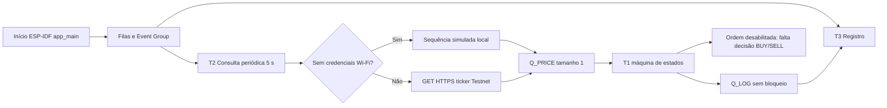

# Arquitetura do projeto

## Estado atual local

O firmware está sendo migrado para **ESP-IDF + FreeRTOS**; `platformio.ini` seleciona `framework = espidf`. O fluxo de build inclui `CMakeLists.txt` na raiz e `src/CMakeLists.txt` como componente ESP-IDF. O build não foi executado porque `pio` e `idf.py` não estavam disponíveis no ambiente examinado.

## Estrutura implementada

```text
include/
  config.h
  secrets.example.h
  services/       # contratos de logging e consulta
  system/         # contexto, filas, sincronização e máquina de estados
  tasks/          # interfaces T1, T2 e T3
src/
  main.cpp
  services/       # cliente de cotação HTTPS e logging
  system/         # filas, Event Group e gatilho
  tasks/          # implementação das três tarefas
test/native/      # teste host da máquina de estados
```

## Fluxo e componentes



### Inicialização e conectividade

`app_main()` inicializa NVS, filas, Event Group e T3. Sem credenciais Wi-Fi locais, ativa modo de cotação simulada. Com credenciais locais, configura ESP-IDF Wi-Fi STA, marca o bit de conexão após receber IP e tenta reconectar após desconexão. Credenciais não são impressas. Não há sincronização SNTP ativa porque a integração de ordens assinadas está bloqueada por decisão de estratégia.

### T1 — gatilho

`TriggerStateMachine` rejeita preços inválidos, usa a primeira cotação apenas como referência, reconhece cruzamento de baixo para cima e de cima para baixo, desarma após um cruzamento e rearma quando o preço fica pelo menos 100 abaixo do limiar. A histerese é herdada do código anterior, não aprovada como requisito. Nenhum cruzamento é convertido em BUY ou SELL.

### T2 — cotação

Usa `vTaskDelayUntil()` com período de 5000 ms. No modo real, usa instância HTTP própria e valida TLS pelo bundle de certificados, status, JSON e preço. No modo simulado, gera valores determinísticos em torno do limiar, sem chamadas externas. Não requer NTP para obter cotação pública.

### T3 — registro

Consome `Q_LOG` e imprime via ESP-IDF logging. As tarefas produtoras não esperam pela Serial. Contabiliza mensagens descartadas e registra o pico de ocupação da fila.

## Comunicação, concorrência e tempo

- `Q_PRICE` tem comprimento 1 e mantém a cotação mais recente; a sequência permite observar amostras não recebidas.
- `Q_LOG` tem comprimento 16 e envio com espera zero.
- Event Group mantém conectividade Wi-Fi.
- Não há mutex global de rede: cada consulta cria/fecha seu próprio cliente e T1 não faz I/O de rede.
- O atraso entre publicação e avaliação é uma métrica local monotônica. RT01 continua não demonstrado: não há ordem transmitida, e o início de transmissão de uma eventual solicitação ainda precisará de instrumentação validada.

## Binance e segurança

Somente a cotação pública da Spot Testnet está implementada. Ordens assinadas não são enviadas até a equipe aprovar lado, quantidade e regra. TLS não é desativado. `include/secrets.h` é local e ignorado pelo Git; `include/secrets.example.h` contém apenas strings vazias. Credenciais que tenham aparecido em commits antigos não são removidas por esta alteração e devem ser rotacionadas pelo proprietário.
